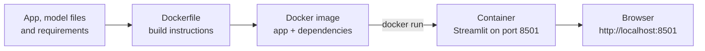

# Laptop Price Predictor

Predict an estimated laptop price with a Streamlit app and a trained machine-learning model. This repository also includes an introductory Docker PDF; the diagram below illustrates how the app is packaged and run in a container.

[Read the Docker introduction PDF](<Introduction to Docker.pdf>)

## How Dockerization works



An **image** is the packaged app and its dependencies; a **container** is a running instance of that image. Docker keeps the Python environment consistent and avoids installing the app's packages directly on your computer.

## Run with Docker

Install and start [Docker Desktop](https://www.docker.com/products/docker-desktop/) first. In a terminal at the repository root, run:

```powershell
cd laptop-price-predictor-regression
docker build -t laptop-price-predictor .
docker run --rm -p 8501:8501 --name laptop-price-predictor laptop-price-predictor
```

Open [http://localhost:8501](http://localhost:8501). The first build downloads the base Python image and installs the app dependencies. Keep the terminal open while using the app; press `Ctrl+C` to stop it. The `--rm` option removes the stopped container automatically.

To run it in the background instead:

```powershell
docker run --rm -d -p 8501:8501 --name laptop-price-predictor laptop-price-predictor
docker logs -f laptop-price-predictor
docker stop laptop-price-predictor
```

## Run without Docker

Use Python 3.9 to match the saved model's scikit-learn version. From the repository root, create and activate a virtual environment, then start Streamlit:

```powershell
cd laptop-price-predictor-regression
py -3.9 -m venv .venv
.\.venv\Scripts\Activate.ps1
python -m pip install -r requirements.txt
streamlit run app.py
```

## Project files

- `laptop-price-predictor-regression/app.py` — Streamlit interface and price prediction.
- `laptop-price-predictor-regression/pipe.pkl` and `df.pkl` — trained model pipeline and laptop data used by the app.
- `laptop-price-predictor-regression/Dockerfile` — instructions for building the app image.
- `laptop-price-predictor-regression/.dockerignore` — excludes training-only and local files from the Docker build context.
- `Introduction to Docker.pdf` — accompanying Docker introduction.

The saved model was trained with scikit-learn 0.24.1. Its dependency versions are pinned in `requirements.txt` because newer scikit-learn releases cannot load this model's serialized tree data.
